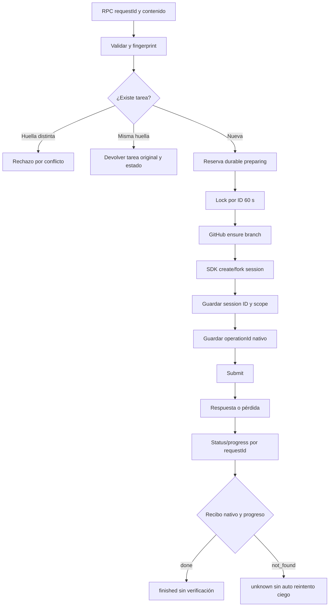
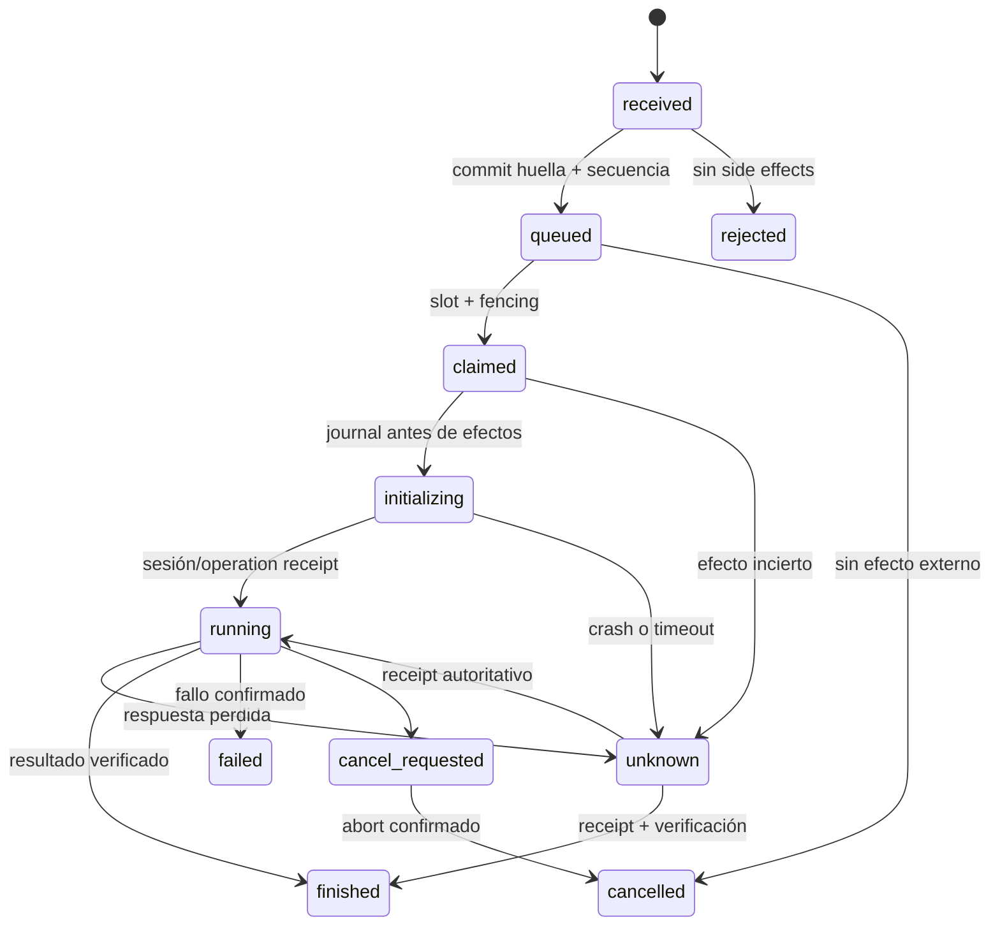

# F0-C10/T03 — Admisión, concurrencia y reconciliación

**Corte:** 2026-11-22, lectura en esta sesión (BRT). **Actor:** ChatGPT (GitHub/Cloudflare/OpenCode Remote lectura; Node offline). **Estado:** `PARTIAL`, no `PASS` del subsistema ni `COMPLETE PASS` global. **No desplegado / no merge.**

## 1. Evidencia, autoridad y versiones

- Fuente auditada: `aamvtrampa36-del/opencode-harness-example`, rama `staging/opencode-g1-rpc-safe-20261120`, **HEAD `11161dd6f2c4b5237a2da59d7275ff693e0afdbe`**. Archivos leídos al SHA fijo: `src/server.ts`, `src/supervisor-control.ts`, `src/staging-control-mcp/server.ts`, `src/supervisor-workflow.ts`, pruebas, `src/github.ts` y `package.json`. No se usó `main` como fuente de Staging.
- Cloudflare GET deployments: principal `opencode-g1-staging`, deployment `36ef84b3-0f99-4dd4-ab8e-c11ee450dd23`, versión `3546687b-4cd2-4e22-8ea9-ee5ea8fd02cb` al 100 %. MCP `opencode-staging-control-mcp`, deployment `9fdaf22d-beeb-44a0-ab68-77ecd5745fa1`, versión `196240c0-1052-47b3-aaa7-02cf5baa87f0` al 100 %. Identidad de runtime, **no** demostración byte a byte de coincidencia con el source.
- Remote `staging_status`: `status=ok`, `ready=true`, `schema=opencode.staging-control.v2`, `supervisedSessions=96`, `supervisedCountComplete=false`; no implica 96 activos.
- [Issue #90: reproducción 22/11](https://github.com/aamvtrampa36-del/opencode-harness-example/issues/90#issuecomment-7083567558): **10 solicitudes de inicio, 0/10 resultados verificados; 6 errores OOM de inicio; 4 en `preparing` canceladas; 2 sesiones `unknown/not_found`**. `a642be2611220007` y `a642be2611220009` obtuvieron sesión pese a fallar su RPC de inicio.
- Contexto documental: `F0_C10_PLAN_INTEGRAL.md`, `03_OPERACION_Y_PERMISOS.md`, `04_PRUEBAS_COSTES_Y_RIESGOS.md`. PR #91/#94 contienen lecturas acotadas; PR #106 es candidata no desplegada según cortes consultados.

## 2. Flujo exacto vigente: requestId → tarea → sesión → operación → resultado

1. MCP `staging_start_task`: ID hexadecimal de 16 caracteres; el supervisor fijo es `opencode-supervisor-v1`. Autenticación externa y guard server-side `OPENCODE_SUPERVISOR_ENABLED=true`.
2. `startSupervisedTask` valida repositorio en allowlist y modelo, normaliza el prompt. `supervisorFingerprint`: SHA-256 del repo normalizado, prompt, modelo o `economy` y sesión origen. Registro `supervisor:task:<id>`.
3. Reserva mediante `ctx.storage.transaction`: si existe con huella diferente rechaza; si coincide reutiliza. Nuevo registro `preparing`, proyecto `supervised-<id>`, rama `opencode/staging-<id>` para el propio repo. **No hay cola global durable ni contador de ejecutores en esta ruta.**
4. `withSupervisorStartLock`: lock por ID con token y caducidad **60 segundos**. Evita carreras dentro de ese plazo, pero no pone fencing sobre efectos externos que puedan seguir después.
5. `advanceSupervisedTask`: GitHub `ensureSupervisorBranch` → guarda SHA base → `harness.sessions.create()/fork()` → asocia scope → escribe `supervisor:session:<ses>` → escribe `job.session` → agente/modelo → almacena `operationId=rc-start-<id>` y `status=running` antes de `handle.submit(...,{operationId,whenBusy:'followUp'})`. Si la respuesta se pierde, marca `unknown`.
6. `staging_task_status` lee registro por ID, `handle.wait` con límite 120ms, `busy`, log incremental acotado y clasificación. Recibo nativo `done` → `finished`; `unanswered/not_found` → `unknown`. Devuelve `passed:false,verified:false`, por lo que `finished` no acredita resultado funcional.
7. `staging_cancel_task` actualmente confirma `cancelled` si no figura `job.session`. **No prueba** ausencia de sesión externa creada antes del commit durable.

## 3. Riesgos y carreras en el código

| Frontera | Riesgo | Invariante propuesto |
| --- | --- | --- |
| Reserva `preparing`/HTTP | La respuesta puede perderse tras guardar el registro | Reconsultar mismo `requestId`; no asumir rechazo |
| Lock de 60s / efecto externo | Un lock vence mientras otro starter sigue vivo | Fencing persistente o estado ambiguo; **no** solo ampliar TTL |
| `sessions.create/fork` → `job.session` | Sesión huérfana, posible segunda creación tras restart | ID determinista de sesión o journal `create_intent` y reconciliación SDK |
| `supervisor:session` y `job.session` | Dos commits separados: mapeo parcial | Commit coordinado de información bajo autoridad del supervisor |
| `running` antes de submit | `running` sin aceptación; `not_found` ambiguo | `submit_intent`, receipt nativo, sin auto reenvío |
| `catch` de init marca `failed` | Puede haber efecto parcial externo | `unknown` si existe efecto incierto |
| Cancel sin sesión guardada | Confirmación `cancelled` posiblemente falsa | Confirmar ausencia de efecto o dejar `unknown` |
| Directory `limit:101` / `busy` | Recuento incompleto y sin actividad demostrada | Telemetría de herramientas/inferencia por operación |

Son ventanas de carrera observables en el diseño actual y reproducibles en un modelo sintético, **no prueba de causalidad del OOM**. T04 debe resolver recuperación profunda, y T02 memoria/aislamiento.

## 4. Máquina de estados

**Actual:** `preparing`, `running`, `finished`, `unanswered`, `failed`, `cancel_requested`, `cancelled`, `unknown`. No fases `queued/claimed`.

**Propuesta, NO aplicada:**

`unknown` debe sobrevivir al TTL y no liberar automáticamente un trabajo que pudo ejecutar efectos. `queued` es trabajo aceptado y persistido; `BACKPRESSURE` ocurre antes de admitirlo, nunca se disfraza de tarea aceptada.

## 5. Contrato idempotente y capacidad

- Clave: `(workspace supervisor, requestId)`. Misma huella normalizada devuelve misma tarea y progreso sin crear otra; huella diferente rechaza **antes de efectos**, también si cambia modelo o `sourceSession`. Distintos IDs permiten tareas distintas aunque el prompt coincida.
- `operationId=rc-start-<requestId>` se conserva. **No** equivale a exactly-once si SDK/native receipts se han perdido: `not_found` no autoriza otro submit.
- Admisión durable mínima: reserva de huella, orden FIFO y estado bajo transacción atómica del único owner. Un despachador acotado toma trabajos con leases/fencing; registra intento antes del efecto y exige recibo para confirmar ejecución. No añadir Cloudflare Queues ni Workflows como segundo scheduler sin benchmark.
- Capacidad es **dinámica y medible**, sin tope permanente de dos. El modelo offline usa `runningCapacity=10` y permite verificar que 10 claims son posibles, **no** que exista memoria/inferencia suficiente para ejecutarlos. Un límite 1/2/4 en ensayos es temporal; F0-C10 exige 10 activos observados.
- Fairness: orden FIFO por secuencia durable dentro del nivel de prioridad; evitar confiar en orden de `Promise.all`. Políticas multi-tenant y provider rate limit se tratan cuando haya medición. Un slot `unknown` puede mantenerse ocupado por seguridad hasta reconciliarse, con telemetría y intervención, no por siempre silenciosamente.
- La capacidad/cola controla aceptación, no memoria compartida de Durable Objects. Si diez sesiones SDK saturan un isolate, T02 debe distribuir ejecución sin duplicar el ledger de admisión.

**Comparación:** (A) ledger transaccional + dispatch limitado dentro del DO existente — coste/complexidad menor, primera opción sujeta a pruebas; (B) cola externa + workers propios — más componentes y doble reconciliación; considerar solo si se demuestra el límite estructural de A.

## 6. Pruebas RED/GREEN reproducibles

`scripts/f0-c10-t03/admission.mjs` es un **modelo de referencia offline in-memory**, no código usado por el supervisor. Serializa transacciones sintéticas, aplica fingerprint y conflictos, FIFO, backlog, claims con capacidad configurable (10 default), operación determinista, `unknown` sin autorreintento, progresos secuenciales y `finished` verificado. Token de claim `claim-N` es solo un fixture; **no fencing real para producción**.

`node --test scripts/f0-c10-t03/admission.test.mjs` (Node 22.16.0): **13 PASS / 0 FAIL / exit 0**. Cubre 10 admitidos concurrentes, 100 retries idénticos, huella diferente, FIFO, backlog completo, límites 2/10, pérdida de respuesta, OOM, `not_found`, conflicto de claim, recibo done no verificado, secuencia de progreso y escalera 1→2→4→10. Que 10 claim reciban progreso sintético NO es evidencia de diez procesos reales.

`node --test scripts/f0-c10-t03/known-red.red.mjs` (ejecución separada): **2 FAIL esperados / exit 1**. Simula (1) crash después de `sessions.create` y antes de guardar sesión: dos sesiones en vez de una; (2) lock vencido 60s con efecto anterior vivo: `peak=2` starters para un ID. **Son simulaciones source-shaped**, no pruebas del Durable Object. El fichero `.red.mjs` se ejecuta deliberadamente fuera de la suite verde.

**Estado del cambio:** se agregó instrumento de prueba aislado y documentación, **no adaptador durable**, sin modificaciones `src/server.ts`. No se ejecutaron Bun/typecheck/build localmente: Bun no está instalado en el entorno offline. CI del HEAD es gate separado. Se evita introducir una cola prematura y convertir falsamente F0-C10 en dos ejecutores.

## 7. Métricas para demostrar 10 ejecuciones reales

Separar `received`, `admitted`, `queued`, `claimed`, `running_receipt`, `busy_verified`, **`active_execution`**, `finished_verified`, `unknown`, `orphan_count`, `reconciled`, `OOM`, `capacity_rejected`, `retry/dedupe`. Cada evento debe portar `experiment_id,requestId,taskId,sessionId,operationId,executorId,branch,baseSHA,workerVersion,timestamp,seq,tool/inference kind,exitCode`, evitando salidas/secretos grandes.

Exigir diez intervalos de **actividad instrumentada real** de ejecutores distintos con intersección temporal positiva y avances correlacionados del log dentro de la ventana, seguidos de diez resultados recuperables y correctos. `peakRunning=10`, `busy=true`, diez MCP starts o diez filas en cola NO bastan. Medir también `queueWaitMs p50/p95`, ocupación, fairness, OOM, reconciliación, coste por tarea y entregas verificadas.

## 8. Validación progresiva y STOP

1. **Offline, hecho para modelo:** 13/13 GREEN, 2/2 RED esperados. A continuación tests de integración sobre DO real: inyectar fallo antes/después de cada `await` de branch/session/submit y verificar journal + unicidad tras restore sin segunda operación.
2. **PR/CI:** `bun test`, `bun run typecheck`, `bun run build`, invariantes del HEAD y revisión de cambios T02/T04. RED separado no se debe confundir con suite verde.
3. **Staging 1→2:** posterior lote que verifique reserva atómica exclusiva, coste con corte efectivo, SHA/source↔deployed, memoria; este T03 no realizó tareas Remote por falta de esas precondiciones.
4. **Staging 4→10:** solo en integración autorizada, instrumentar diez verdaderamente activos, tres rondas con 10/10 resultados, sin OOM/huérfanos/duplicados, incluyendo errores negativos y recuperación. El gate no admite limitación permanente a dos.
5. **STOP:** estado `unknown` sin ruta segura, OOM, SHA ambiguo, permiso/scope inválido, coste no acotable, pérdida del lease, nuevo side effect, output sin límite. Nunca reiniciar con requestId nuevo después de timeout.

No se llamó `staging_start_task`, `staging_agent_check` ni a modelos. No mutaciones Cloudflare, Production, main, migraciones, secrets, merge o deploy.

## 9. Investigación externa

- [Cloudflare Rules of Durable Objects](https://developers.cloudflare.com/durable-objects/best-practices/rules-of-durable-objects/): `await` de red intercalable pese al thread único; transacción para read-modify-write.
- [Cloudflare Durable Object storage](https://developers.cloudflare.com/durable-objects/best-practices/access-durable-objects-storage/): durabilidad y evicción.
- [Celery optimizing/prefetch](https://github.com/celery/celery/blob/main/docs/userguide/optimizing.rst): distinguir prefetch de slots reales.
- [SQS FIFO deduplication](https://docs.aws.amazon.com/AWSSimpleQueueService/latest/SQSDeveloperGuide/sqs-fifo-queue-message-identifiers.html) y [outage recovery](https://docs.aws.amazon.com/AWSSimpleQueueService/latest/SQSDeveloperGuide/designing-for-outage-recovery-scenarios.html): idempotencia y ventanas de visibilidad limitadas.
- [Temporal worker options](https://github.com/temporalio/sdk-typescript/blob/main/packages/worker/src/worker-options.ts): capacidad de worker distinta de backlog. No se adapta una plataforma completa.
No se copió código de terceros ni se agregaron dependencias.

## 10. Handoff y aceptación

**T04:** investigar ID determinista `sessions.create/fork`, `create_intent`, binding durable, receipt nativo y cancelaciones prematuras. **T02:** medir memoria con sesiones concurrentes y aislar ejecutores si es necesario. **T10:** no contar `busy` sin intervalos de actividad reales. Las PR de otros especialistas pueden coexistir; este T03 no modifica su código ni el registro común.

**PASS T03** solo con adaptador productivo durable y fencing real, pruebas de fallos RED→GREEN reproducibles de admisión/reconciliación, CI del HEAD, sin tareas inaccesibles o duplicadas. Actualmente **`PARTIAL`**. **`COMPLETE PASS` global** requiere además E2E autorizado diez actividades verdaderamente solapadas y outputs verificados, 3 rondas, métricas/costes e integridad.

**Recibo maestro:** `F0-C10/T03 | PARTIAL | Actor ChatGPT | Source 11161dd6f2c4b5237a2da59d7275ff693e0afdbe | Worker 3546687b-4cd2-4e22-8ea9-ee5ea8fd02cb | MCP 196240c0-1052-47b3-aaa7-02cf5baa87f0 | Node offline GREEN 13/13 exit0 | RED sintético 2/2 exit1 | Remote nuevos requestId/sessionId/operationId: ninguno | Inferencia nueva: ninguna | No deploy/merge | Próxima acción: coordinar T04 e integrar journal/claims reales bajo pruebas, antes de lote Stage`.
